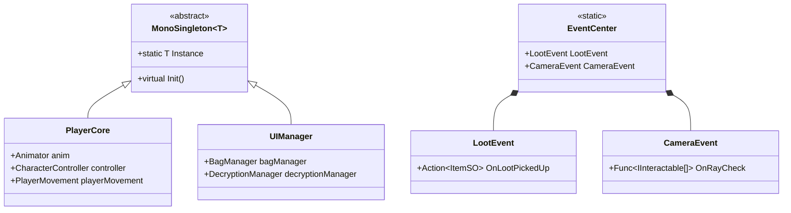
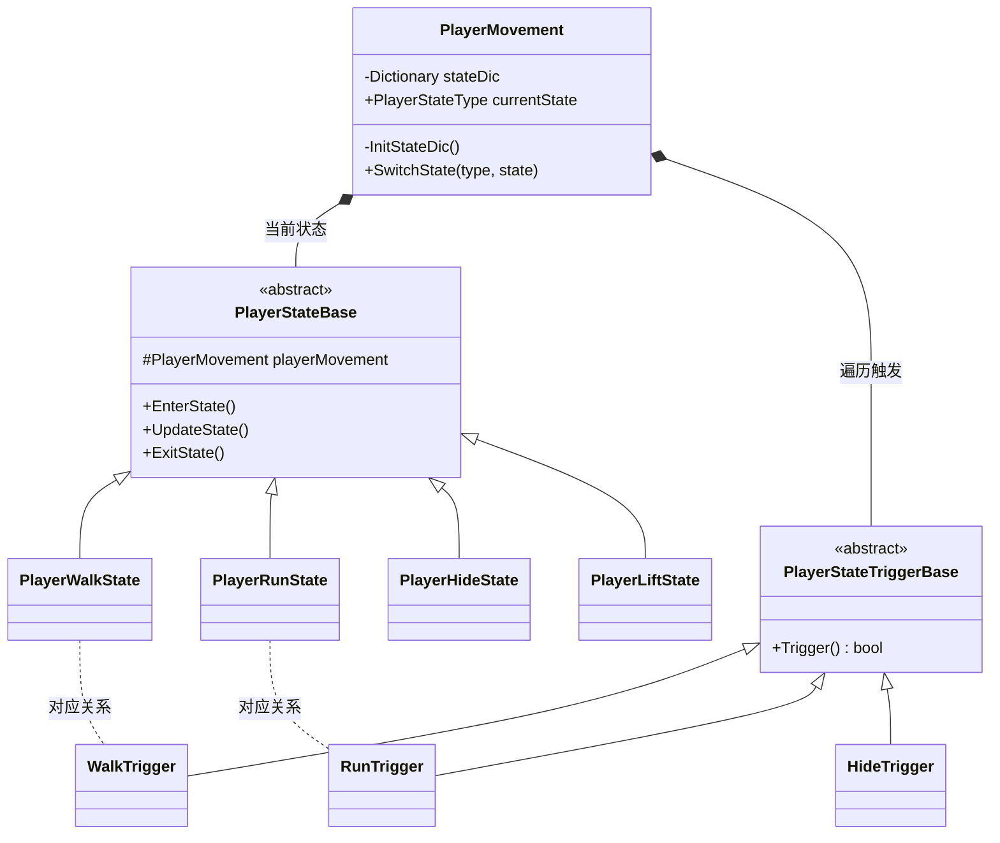
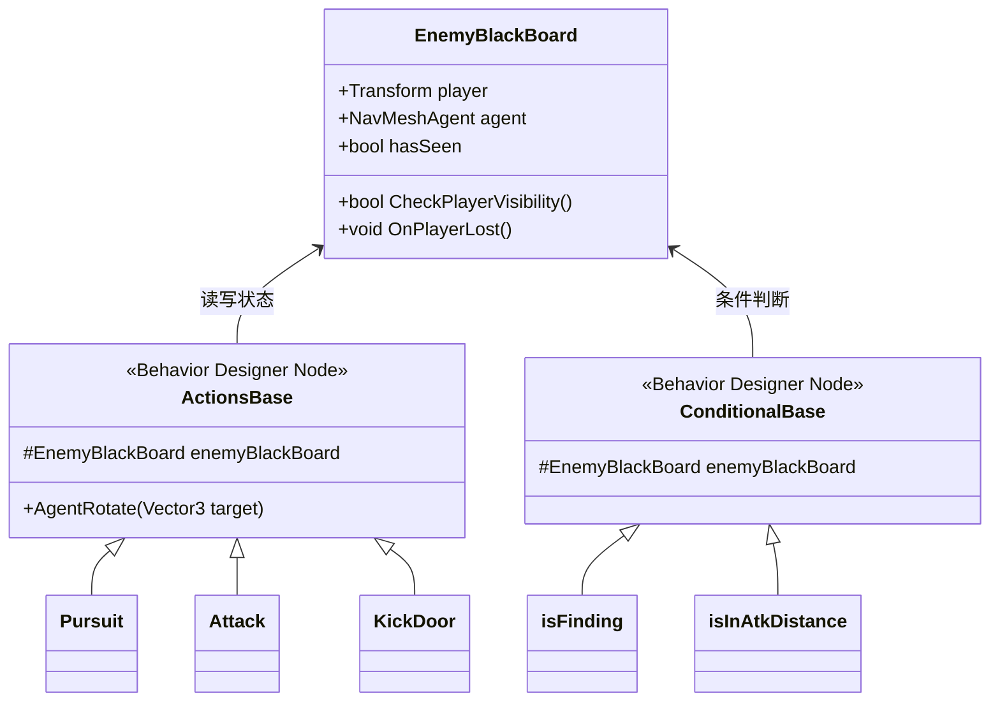
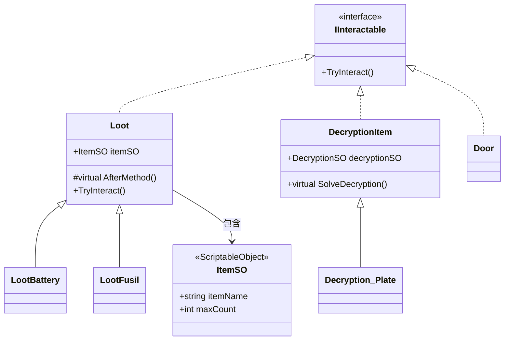

#  技术架构与实现详解 (Technical Architecture)

> 本文档详尽说明了《恐怖潜行解谜游戏》的核心系统架构、模块职责、设计模式应用，以及项目在跨平台工程化中遇到的技术难点与解决方案。

##  技术栈总览
- **引擎与语言**：Unity (URP) / C#
- **AI 系统**：Behavior Designer (行为树) / 黑板模式
- **音频中间件**：Wwise (深度定制与 WebGL 内存流加载)
- **相机控制**：Cinemachine
- **存档系统**：Easy Save 3
- **输入系统**：Unity Input System

---

##  1. 核心框架层 (Core Framework)

**模块职责**：提供全局访问入口，解耦各子系统之间的依赖，管理游戏的基础运行环境。
**技术应用**：
- **泛型单例 (Generic Singleton)**：`MonoSingleton<T>` 实现了按需加载，避免场景冗余挂载，同时保证了全局唯一性。
- **事件中心 (Event Center)**：基于 C# `Action`/`Func` 委托构建静态事件容器。彻底解耦“输入检测”、“交互目标”与“UI更新”，使代码符合开闭原则。



---

##  2. 玩家系统：反射驱动的状态机 (FSM)

**模块职责**：处理玩家移动、视角、生命值、动画以及复杂的状态切换（行走、奔跑、躲藏、搬运等）。
**技术应用**：
- **状态模式 (State Pattern)**：摒弃臃肿的 `if-else`，将每种状态封装为独立的类（`PlayerStateBase` 的派生类）。
- **C# 反射 (Reflection)**：在 `InitStateDic` 中，利用反射结合命名约定（如 `PlayerWalkState` / `WalkTrigger`），在运行时自动注册状态。新增状态无需修改原有核心代码，完美遵循**开闭原则 (OCP)**。



---

##  3. 敌人 AI：黑板模式与行为树

**模块职责**：实现敌人的感知、巡逻、追击、攻击及破门逻辑。
**技术应用**：
- **黑板模式 (Blackboard Pattern)**：将 AI 的共享数据（玩家位置、最后发现位置、视野状态）集中存放在 `EnemyBlackBoard` 中，供所有行为节点读取。
- **性能优化**：手写双扇形物理射线检测（前视 150° / 后视 210°），并加入了 1 秒的射线冷却缓存（`raycastInterval`），极大优化了多 AI 同屏时的性能。



---

##  4. 交互与物品系统 (Interaction & Item)

**模块职责**：处理玩家与场景物体的交互，以及背包数据的增删改查。
**技术应用**：
- **面向接口编程**：所有可交互物（门、战利品、解密机关）均实现 `IInteractable` 接口，玩家相机只需通过射线获取接口并调用 `TryInteract()`。
- **模板方法模式**：战利品基类 `Loot` 固定了拾取流程（检测背包 -> 播放动画 -> 添加物品），子类只需重写 `AfterMethod()` 处理特殊剧情（如拾取保险丝触发刷怪）。
- **数据驱动**：所有物品配置均使用 `ScriptableObject`（`ItemSO`），实现数值与代码分离。



---

##  5. 工程化与跨平台实战 (WebGL 适配)

为了让游戏能在 itch.io 提供免下载试玩，项目完成了深度的 WebGL 平台适配。

###  痛点 1：IL2CPP 代码裁剪导致反射失效
- **原因**：WebGL 打包时 IL2CPP 会裁剪未直接引用的代码。而 FSM 依赖**反射字符串查找**，状态类会被误删导致崩溃。
- **解决**：编写定制化 `link.xml` 文件，强制保留 `ns` 命名空间下的所有代码，并调整 Managed Stripping Level 为 `Low`。

###  痛点 2：Wwise 音频引擎在浏览器沙箱中无法读取文件
- **原因**：浏览器安全沙箱禁止底层代码直接通过文件路径读取 `.bnk` 音频文件。
- **解决**：重写加载逻辑，使用 `UnityWebRequest` 以字节流读取文件，利用 **`GCHandle` 将内存固定（Pinned）获取指针**，直接将内存地址传给 Wwise 底层接口。

```csharp
// 核心突破：WebGL 下通过内存指针加载音频，绕过浏览器文件沙箱限制
GCHandle pinnedHandle = GCHandle.Alloc(bankData, GCHandleType.Pinned);
System.IntPtr bankPtr = pinnedHandle.AddrOfPinnedObject(); 

try
{
    // 传入内存指针和大小，而非文件路径
    AKRESULT result = AkUnitySoundEngine.LoadBankMemoryCopy(
        bankPtr, (uint)bankData.Length, out uint bankID
    );
}
finally
{
    if (pinnedHandle.IsAllocated) pinnedHandle.Free(); // 加载完毕立刻释放句柄
}
```

---

##  6. 性能优化细节 (Performance)

1.  **渲染优化**：战利品发光效果采用 `MaterialPropertyBlock` 修改自发光属性，避免了 `Renderer.material` 带来的材质实例化（Material Instantiation）和内存暴增。
2.  **对象池 (Object Pool)**：`TrapManager` 中针对捕熊夹实现了对象池复用，避免频繁 `Instantiate` 和 `Destroy` 产生大量的内存碎片。
3.  **异步存档**：Easy Save 3 存档时采用协程分帧读写，且剥离纯数据结构（避免序列化 Component），防止瞬间卡顿。
